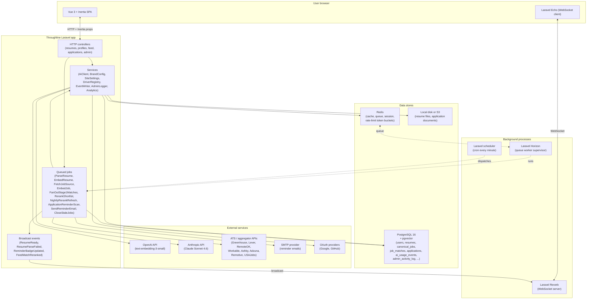
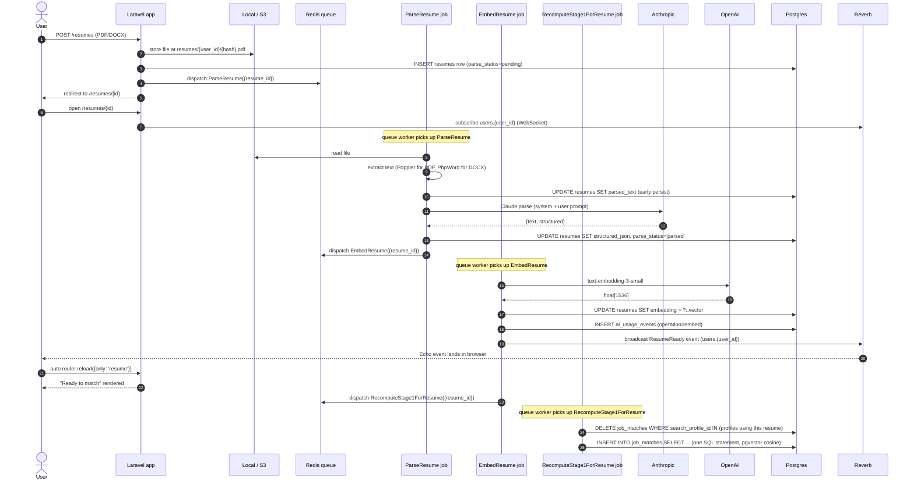
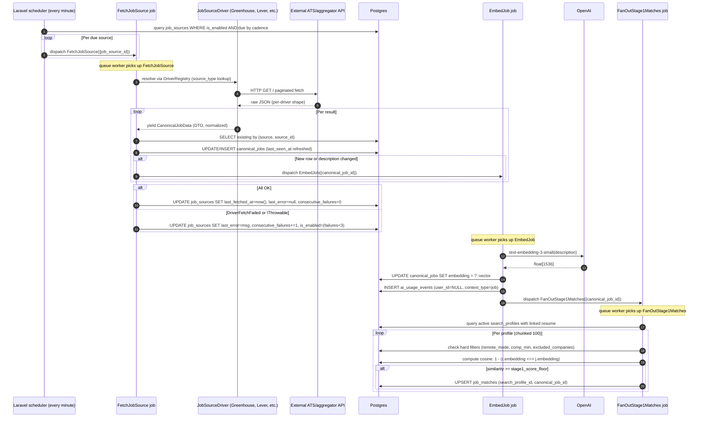
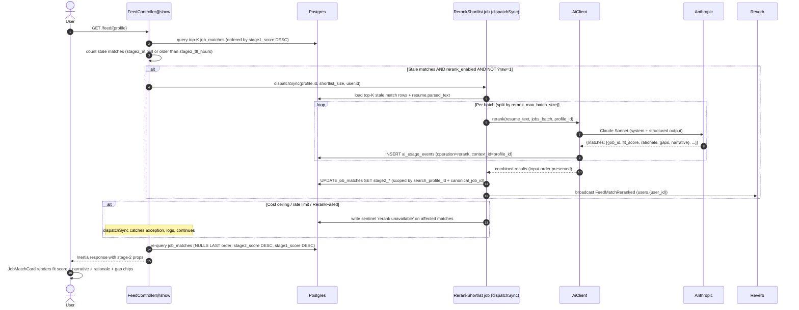
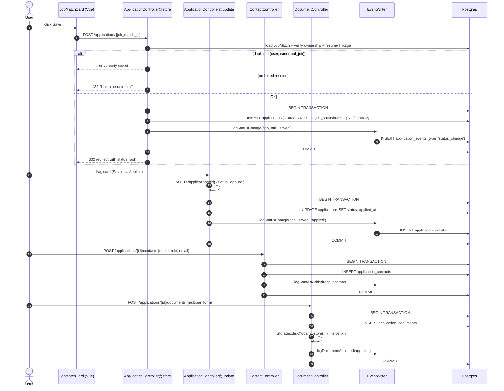
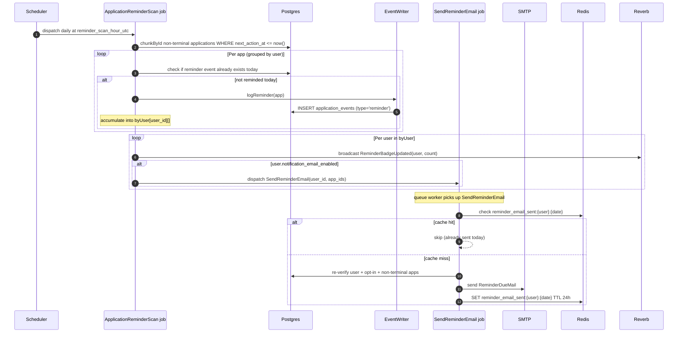
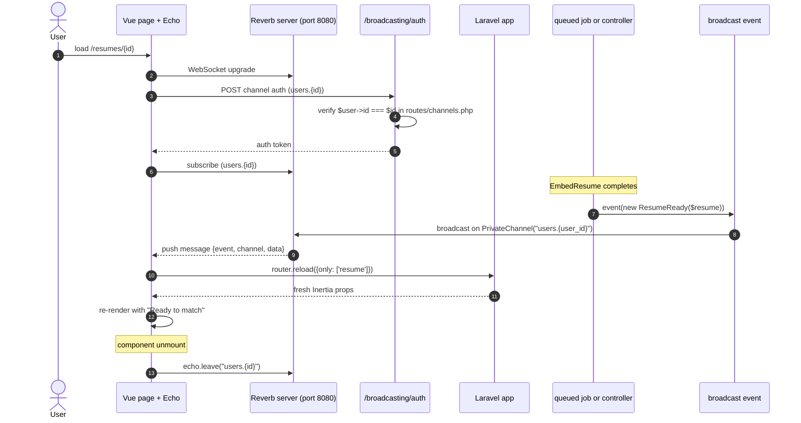

# Architecture

This is the technical deep-dive. For a higher-level introduction, see the [main design spec](superpowers/specs/2026-04-21-throughline-design.md). For sub-plan decisions, the `superpowers/specs/2026-04-2*-throughline-plan-*-design.md` documents explain why each plan's boundaries are where they are.

## Table of contents

- [System overview](#system-overview)
- [Data model](#data-model)
- [The resume pipeline](#the-resume-pipeline)
- [The ingestion pipeline](#the-ingestion-pipeline)
- [The matching pipeline](#the-matching-pipeline)
- [The application pipeline](#the-application-pipeline)
- [Real-time events](#real-time-events)
- [Security and authorization](#security-and-authorization)
- [Key design decisions](#key-design-decisions)

---

## System overview



### Layered responsibilities

- **HTTP controllers** are thin — they validate form requests, delegate to services, dispatch queued jobs, fire broadcast events, and return Inertia responses.
- **Services** own the business logic. They're where the "how" lives.
- **Queued jobs** are the async backbone. Anything that takes longer than a page-render budget (parsing, embedding, fetching, reranking, fan-out) goes through a job.
- **Events** decouple the write path from the push-notification path. Every broadcast dispatch site is wrapped in try/catch — a failed push never aborts the primary DB write.
- **Reverb + Echo** carry real-time updates on private `users.{id}` channels.

---

## Data model

```mermaid
erDiagram
    users ||--o{ resumes : "has many"
    users ||--o{ search_profiles : "has many"
    users ||--o{ applications : "has many"
    users ||--o{ social_accounts : "has many"
    users ||--o{ admin_activity_log : "performs (as admin)"
    users ||--o{ ai_usage_events : "attributes to"

    resumes ||--o{ search_profiles : "0..1 linked"
    resumes ||--o{ applications : "snapshot reference"

    search_profiles ||--o{ job_matches : "fans out into"
    search_profiles ||--o{ applications : "origin (nullable)"

    canonical_jobs ||--o{ job_matches : "scored against"
    canonical_jobs ||--o{ applications : "saved from"

    applications ||--o{ application_events : "audit trail"
    applications ||--o{ application_contacts : "recruiters, etc."
    applications ||--o{ application_documents : "cover letters, etc."

    job_sources ||--o{ canonical_jobs : "via driver fetch"

    site_settings }o--|| users : "admin-edited"

    users {
        id bigint PK
        email string UK
        name string
        password string nullable
        role enum "user|admin"
        last_login_at timestamp
        deactivated_at timestamp nullable
        notification_email_enabled bool
    }

    resumes {
        id bigint PK
        user_id FK
        name string
        source_file_path string
        source_mime string
        parsed_text text
        structured_json jsonb
        parse_status enum
        is_default bool
        embedding vector_1536
    }

    search_profiles {
        id bigint PK
        user_id FK
        resume_id FK nullable
        name string
        role_keywords jsonb
        locations jsonb
        remote_mode enum
        comp_min int
        comp_currency string
        industries jsonb
        seniority_levels jsonb
        excluded_companies jsonb
        is_active bool
    }

    canonical_jobs {
        id bigint PK
        source string
        source_id string
        source_board string
        company_name string
        title string
        description text
        location_raw string
        locations jsonb
        remote_mode enum
        comp_min int
        comp_max int
        comp_currency string
        seniority string
        employment_type string
        apply_url string
        posted_at timestamp
        last_seen_at timestamp
        closed_at timestamp nullable
        raw_payload jsonb
        embedding vector_1536
    }

    job_matches {
        id bigint PK
        user_id FK
        search_profile_id FK
        canonical_job_id FK
        stage1_score float
        stage2_score int nullable
        stage2_rationale text nullable
        stage2_gaps jsonb nullable
        stage2_narrative text nullable
        stage2_at timestamp nullable
        dismissed_at timestamp nullable
    }

    job_sources {
        id bigint PK
        source_type string
        identifier string nullable
        display_name string
        is_enabled bool
        fetch_cadence_minutes int
        last_fetched_at timestamp
        last_error text
        consecutive_failures int
        config_json jsonb nullable
    }

    applications {
        id bigint PK
        user_id FK
        canonical_job_id FK
        search_profile_id FK nullable
        resume_id FK nullable
        status enum
        applied_at timestamp nullable
        next_action_at timestamp nullable
        notes text
        stage2_snapshot jsonb
    }

    application_events {
        id bigint PK
        application_id FK
        type enum
        payload jsonb
        occurred_at timestamp
    }

    application_contacts {
        id bigint PK
        application_id FK
        name string
        role enum
        email string
        phone string
        linkedin_url string
        notes text
    }

    application_documents {
        id bigint PK
        application_id FK
        kind enum
        file_path string
        file_name string
        mime string
        size_bytes int
        uploaded_at timestamp
    }

    ai_usage_events {
        id bigint PK
        user_id FK nullable
        provider string
        model string
        operation string
        input_tokens int
        output_tokens int
        estimated_cost_usd decimal
        context_type string
        context_id string nullable
    }

    admin_activity_log {
        id bigint PK
        admin_user_id FK
        action string
        target_type string nullable
        target_id bigint nullable
        payload jsonb
        ip string
        created_at timestamp
    }

    site_settings {
        id bigint PK
        key string UK
        value text
        type enum
        description string
        updated_by FK nullable
        updated_at timestamp
    }

    social_accounts {
        id bigint PK
        user_id FK
        provider string
        provider_user_id string
        access_token text encrypted
        refresh_token text encrypted
    }
```

### Table highlights

- **Vectors live per-entity.** `resumes.embedding` and `canonical_jobs.embedding` are both `vector(1536)` (pgvector). There's no shared vector store — each table owns its own column. The `ivfflat` index is created immediately on migration; see [pgvector retuning](reference.md#pgvector-retuning) for when to rebuild.
- **`job_matches` is fan-out, not computed on the fly.** Every `(search_profile_id, canonical_job_id)` pair gets a row; feed queries are indexed lookups. The unique constraint is `(search_profile_id, canonical_job_id)` so inserts are idempotent.
- **`application_events` is append-only** — the Eloquent model's `booted()` hook throws `LogicException` on update. Corrections happen via compensating events.
- **`stage2_snapshot` on `applications`** preserves the rerank output as of save-time, so a later rerank overwriting the live `job_matches` row doesn't retcon the user's saved context.
- **`admin_activity_log` is append-only** (same pattern). The `AdminLogger` service is the single writer; every mutating admin action writes a row.
- **`ai_usage_events.context_id`** carries the search profile id for rerank calls — enables per-profile (and transitively per-user) cost attribution in admin analytics.

---

## The resume pipeline



### Failure modes

- **Claude parse fails (unparseable JSON):** `ParseResume` catches `ParseFailed`, stores raw extracted text in `parsed_text`, sets `parse_status = parse_failed`. User sees a "Parse failed — paste manually" state. Broadcasts `ResumeParseFailed`.
- **OpenAI embed hits cost ceiling:** `EmbedResume` catches `CostCeilingExceeded`, releases the job with a delay to midnight. User's resume stays in "parsed but embedding pending" state.
- **OpenAI rate-limited:** `EmbedResume` catches `ProviderRateLimited`, releases with the provider-supplied retry-after value.
- **Poppler missing at `ParseResume::extractRawText`:** Caught as `\Throwable`, resume transitions to `parse_failed`. The `EmbedResume` step never runs. Retry from the UI once Poppler is installed.
- **Reverb push fails:** try/catch around `event(...)` logs a warning and continues. Primary DB writes already succeeded; only the push is lost. The 30-second polling fallback on the resume detail page catches up.

### Why `RecomputeStage1ForResume` uses a single SQL statement

Plan 2 Task 12's initial implementation chunked through jobs one at a time, fetching each embedding separately — an N+1 against pgvector. Plan 3's review flagged this. The fix (committed in Plan 3 Task 12 / Plan 2 PR fix-up) is a single `INSERT INTO job_matches SELECT ...` that runs the cosine similarity + hard-filter + floor check all in Postgres:

```sql
INSERT INTO job_matches (user_id, search_profile_id, canonical_job_id, stage1_score, created_at)
SELECT ?, ?, cj.id, 1 - (r.embedding <=> cj.embedding) AS score, NOW()
FROM canonical_jobs cj, resumes r
WHERE r.id = ?
  AND cj.embedding IS NOT NULL
  AND cj.closed_at IS NULL
  AND 1 - (r.embedding <=> cj.embedding) >= ?
  AND cj.remote_mode IN (...)   -- hard filters
  AND (cj.comp_min IS NULL OR cj.comp_min >= ?)
```

---

## The ingestion pipeline



### `JobSourceDriver` contract

The interface is deliberately narrow:

```php
interface JobSourceDriver {
    public function sourceType(): string;
    public function fetch(JobSource $source): iterable;  // yields CanonicalJobData
    public function validateIdentifier(?string $identifier): bool;
}
```

Every driver yields the same `CanonicalJobData` DTO regardless of the upstream shape. `FetchJobSource` handles the database side; drivers never touch Eloquent. This is what lets us add a driver in Plan 3 without reshaping matching code.

See [reference.md — job source drivers](reference.md#job-source-drivers) for the shape each of the 8 drivers normalizes from.

### Auto-pause

After 3 consecutive failures the source flips `is_enabled = false`. The scheduler stops dispatching. An admin re-enables it via the sources page once the upstream issue is resolved.

---

## The matching pipeline



### Sync vs async rerank

- **Sync** (`dispatchSync`) fires from `FeedController@show` when a user opens their feed and the top-K has stale rows. Budget is ~3 seconds — the page re-queries after the sync call completes and returns fresh stage-2 props.
- **Async** (`dispatch`) fires from `NightlyRerankRefresh`, which runs daily at `site_settings.nightly_rerank_hour_utc` (default 04:00 UTC). It queues one `RerankShortlist` per active profile with `shortlist_size = 50`, no acting user. Morning feed views find the top-50 already fresh; only scroll-past-page-1 hits the synchronous path.

### `AiClient::rerank` all-or-throw

The client takes a batch of jobs and returns exactly one entry per input. If Claude omits a job or returns an entry without all required fields, `AiClient` throws `RerankFailed` — it never returns partial results. `RerankShortlist` catches `RerankFailed` and writes the sentinel, preventing a retry loop on a consistently-bad prompt.

Internal batching splits inputs larger than `rerank_max_batch_size` (default 20) into sequential Claude calls. Each batch writes its own `ai_usage_events` row.

### Critical correctness detail: multi-user scoping

Plan 3's final review caught a bug where `RerankShortlist::applyResults` was scoping its `UPDATE job_matches` query only by `canonical_job_id`. In a multi-user deployment, User A's rerank would have overwritten User B's stage-2 data for the same canonical job. The fix (PR #16) scopes by `(search_profile_id, canonical_job_id)` — the unique index on that column pair. A regression test seeds two users on the same job and asserts only the requesting profile's row changes.

---

## The application pipeline



### The append-only event log

`application_events` is the durable trail. Every mutating application action produces a row:

| Event type | Written by | Payload shape |
|---|---|---|
| `status_change` | `ApplicationController@store`, `update`, `destroy` | `{from, to}` |
| `note` | `ApplicationController@update` (when notes changed) | `{body}` |
| `interview` | `EventWriter::logInterview` (not yet wired to UI) | `{stage, scheduled_for, ...}` |
| `reminder` | `ApplicationReminderScan` | `{next_action_at}` |
| `contact_added` | `ContactController@store` | `{contact_id, role}` |
| `document_attached` | `DocumentController@store` | `{document_id, kind}` |

The model's `booted()` hook rejects updates — if anyone calls `$event->update(...)` it throws `LogicException`. To "correct" an event, write a compensating event.

### Why file-before-DB is wrong

Plan 4's final review caught `DocumentController::store` writing the file to disk *before* opening the DB transaction. If the DB insert then failed, the file was orphaned. The fix (PR #17 final commit) moves the `Storage::disk()->store()` call inside the transaction. The residual edge case — file write succeeds, DB insert throws — still leaves an orphaned file, which is acceptable: recoverable via cleanup, no DB pollution.

### Reminder scan



The cache-based dedupe prevents queue retries from double-sending.

---

## Real-time events



### The four broadcast events

| Event class | Fired by | Payload | Consumed by |
|---|---|---|---|
| `ResumeReady` | `EmbedResume` after vector write | `{resume_id, parse_status, has_embedding}` | `/resumes/{id}` Show page |
| `ResumeParseFailed` | `ParseResume` on transition to `parse_failed` | same as above with `parse_status='parse_failed'` | same page |
| `ReminderBadgeUpdated` | `ApplicationReminderScan` + `ApplicationController@update/destroy` | `{count}` | nav badge (`NavMain.vue`) |
| `FeedMatchReranked` | `RerankShortlist` after last batch lands | `{search_profile_id, updated_at}` | `/feed/{profile}` Show page |

### The dispatch contract

Every event fire site wraps in try/catch:

```php
try {
    event(new ResumeReady($resume->fresh()));
} catch (\Throwable $e) {
    Log::warning('ResumeReady broadcast failed', ['resume_id' => $resume->id, 'error' => $e->getMessage()]);
}
```

This means a failed push — Reverb down, serialization bug, network hiccup — never aborts the primary DB write. The fallback polling loop on pages that subscribe (resume detail: 30s; feed: naturally on refresh) keeps users unblocked.

### Channel auth

Private channels use `routes/channels.php`:

```php
Broadcast::channel('users.{userId}', function ($user, $userId) {
    return (int) $user->id === (int) $userId;
});
```

Users can only subscribe to their own channel. If a malicious client tries to subscribe to `users.999999`, the broadcast auth returns 403.

---

## Security and authorization

### Authentication surfaces

- **Email + password** — Laravel's default, backed by the `users` table.
- **Google OAuth** — via Laravel Socialite, creates/updates `social_accounts` linked to a `users` row.
- **GitHub OAuth** — same pattern.

The `SocialiteController@callback` is the merge point: if the provider identity (`provider_user_id`) already has a `social_accounts` row, log in that user; otherwise create a new user + social account. First user on a fresh install is auto-promoted to admin.

### Authorization layers

Plan 5 consolidated all admin routes under one middleware group:

```php
Route::middleware(['auth', \App\Http\Middleware\EnsureAdmin::class])
    ->prefix('admin')
    ->name('admin.')
    ->group(function () { /* every admin route */ });
```

`EnsureAdmin` checks `$user->isAdmin() && !$user->isDeactivated()` — a deactivated admin can't bypass the middleware. Non-admin users get 403 on any `/admin/*` route.

Per-resource ownership checks happen in the controller:

```php
abort_unless((int) $resource->user_id === $request->user()->id, 403);
```

Every user-facing CRUD operation (resumes, search profiles, applications, contacts, documents, feed) has these checks. Form-request `authorize()` methods do a belt-and-suspenders layer.

### Impersonation

One-level only:

- `POST /admin/impersonate/{user}/start` — admin-gated. Checks nested impersonation is not in progress, target is not an admin. Stashes `original_user_id` in session, `Auth::login($target)`, regenerates session, re-stashes key (regenerate wipes).
- `POST /impersonate/stop` — `auth`-only (not admin-gated, since the current user isn't admin while impersonating). Reads `original_user_id`, `Auth::login($admin)`, clears session key, regenerates.
- A persistent red `<ImpersonationBanner>` shows across the top whenever `session.original_user_id` is set.
- Every impersonation start and stop writes an `admin_activity_log` entry.

### Admin audit

`AdminLogger::record` is the single writer of `admin_activity_log`. Every controller extending `Admin\BaseController` calls `$this->audit($action, $target, $payload)` on mutating actions. Log failures are swallowed (`Log::warning` + return null) — we'd rather the admin's action succeed than a log-table outage break their workflow.

### Secrets handling

- API keys (OpenAI, Anthropic, Adzuna, USAJobs, OAuth client secrets) live in `.env`.
- The admin Settings page lists these under a "read-only, masked" section — the app never edits env-sourced secrets via the UI.
- `social_accounts.access_token` and `refresh_token` are `encrypted` casts — stored encrypted at rest via Laravel's APP_KEY.
- Resume + application document files are stored on a non-web-accessible disk (`storage/app/private/...` or an S3 private bucket). Downloads stream through an authorized controller action.

### Brand-string leak guard

`BrandStringLeakTest` rejects literal `"Throughline"` occurrences outside an allowlist (`BrandConfig` service, `config/brand.php`, docs, tests, mail templates, README/CHANGELOG, GitHub workflow files). This forces code to read the name via `BrandConfig::name()` or the Inertia-shared `siteName` prop, which in turn honors `site_settings` overrides — so operators can rebrand without a code change.

### Cost ceiling

`site_settings.cost_ceiling_per_user_per_day_usd` (default `5.00`) is checked by `AiClient` on every user-attributed call. Sum of `ai_usage_events.estimated_cost_usd` for the user for the current UTC day; if at or above the ceiling, the call throws `CostCeilingExceeded`. Queued jobs catch this and release with a delay to midnight, so the retry hits after the window rolls over.

System-attributed calls (`forUser(null)` — used by `EmbedJob` for canonical_jobs and by the nightly rerank) don't trip the ceiling.

### Rate limiting

Per-provider token bucket in Redis. `services.ai.rate_limit.openai.max=500`, `per_seconds=60` (default). `Cache::increment` is atomic; we pick up an HTTP 429 from the provider and translate to `ProviderRateLimited` with the upstream retry-after value.

---

## Key design decisions

These are the architecture calls that shaped the codebase — worth knowing if you're extending it.

1. **One vector per table, no shared vector store.** `resumes.embedding` and `canonical_jobs.embedding` live on their respective tables. Simplifies cascades; each table's ivfflat index is independently rebuildable.

2. **`job_matches` fan-out, not on-the-fly computation.** Every `(profile, job)` pair gets a row. Feed queries are indexed lookups, not vector searches. Stage-2 rerank output lives on the same row as stage-1, so a single read gives you everything the card needs to render.

3. **Stage-2 is write-through, not cache.** Once stage-2 columns are populated on a `job_matches` row, they stay until the next rerank. This means: nightly rerank fills stage-2 for the top-50 per active profile; morning feed views are fast. Stale detection (older than `stage2_ttl_hours`, default 24h) triggers sync rerank on feed view.

4. **Append-only event logs.** Both `application_events` and `admin_activity_log` are append-only at the Eloquent layer. Corrections happen via compensating events. This is what makes audit trails trustworthy: nobody can rewrite history by updating a row.

5. **`JobSourceDriver` yields DTOs, never touches the DB.** Drivers know nothing about the database. `FetchJobSource` (the queued job) handles upsert. This is what lets all 8 drivers coexist without conflicts — and it's why adding a 9th driver in a future plan is a one-file addition.

6. **All-or-throw rerank.** `AiClient::rerank` returns exactly one entry per input job or throws `RerankFailed`. Callers don't need partial-result handling.

7. **Cache-based deduplication for side-effects.** `SendReminderEmail` uses `reminder_email_sent:{user}:{date}` with 24h TTL to prevent duplicate sends across queue retries. Same pattern is available elsewhere if future features need idempotency.

8. **First user auto-admin.** `RegisteredUserController::store` and `SocialiteController@callback` both set `role = User::count() === 0 ? 'admin' : 'user'`. Means a fresh install is immediately usable — no out-of-band admin promotion needed.

9. **Append-only implies savepoints.** `AdminLogger::record` wraps its insert in `DB::transaction` because inside a test's outer `RefreshDatabase` transaction, a rejected FK would abort the outer transaction. Savepoint isolates the failure.

10. **No daily-aggregates table in v1.** Analytics queries hit `canonical_jobs`, `job_matches`, `ai_usage_events` directly. Fast enough for realistic v1 data volumes. If queries slow as the dataset grows, a materialized-view or daily-aggregates table lands in a future plan.

---

## Further reading

- Each Plan's design spec under `superpowers/specs/` explains the scope + decisions for that plan.
- The implementation plans under `superpowers/plans/` show the exact task decomposition that built each surface.
- [Reference doc](reference.md) has the exhaustive list of CLI commands, broadcast events, `site_settings` keys, and job-source drivers.
